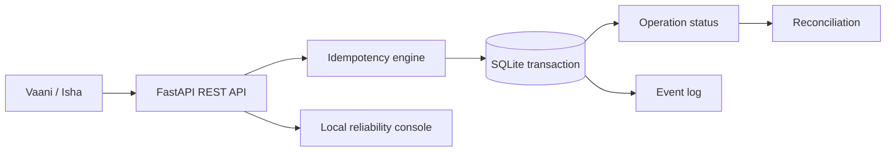

# ResolveAI

ResolveAI is a local, reliability-first appointment backend for a Vaani voice agent. It demonstrates durable idempotency, authoritative operation status, and reconciliation after a lost acknowledgment. It uses FastAPI, SQLAlchemy, SQLite, and a small server-served reliability console.

## Run locally

PowerShell:

```powershell
cd backend
py -3.11 -m venv .venv
.\.venv\Scripts\Activate.ps1
pip install -r requirements.txt
Copy-Item .env.example .env
python -m app.seed
uvicorn app.main:app --host 127.0.0.1 --port 8000 --reload
```

macOS/Linux: `python3 -m venv .venv && source .venv/bin/activate && pip install -r requirements.txt && cp .env.example .env && python -m app.seed && uvicorn app.main:app --host 127.0.0.1 --port 8000 --reload`.

Open `http://127.0.0.1:8000/` and `/docs`. Run tests from `backend` with `pytest -q`.

## Architecture



Customer endpoints require `X-API-Key`; fault and reset controls require `X-Admin-API-Key`. These are shared integration/demo credentials, not caller identity. Never expose admin credentials in a browser. The local dashboard is intentionally lightweight; `/docs` is the source of truth for exact schemas.

## Fault injection and tunnel

Set `POST /admin/fault-mode?mode=TIMEOUT_AFTER_COMMIT` with the admin header. The mutation commits once, then returns 504; query the returned operation from the prior request or use the appointment operation history. For Vaani, localhost is not reachable from the cloud: expose port 8000 using Cloudflare Tunnel or ngrok, then configure `https://YOUR-TUNNEL.example/` and the API key. Tunnel URLs can change and both tunnel and server must stay running.

Known limitations: SQLite is intentionally for local/demo use; no live Vaani call has been validated here; the dashboard is a compact console rather than a separate React app; customer verification is represented by shared demo authorization and should be replaced with real identity verification in production.
